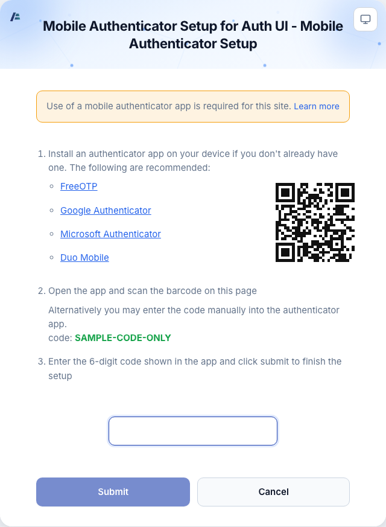
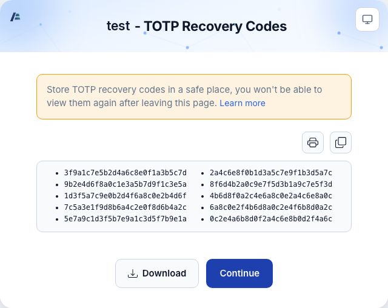
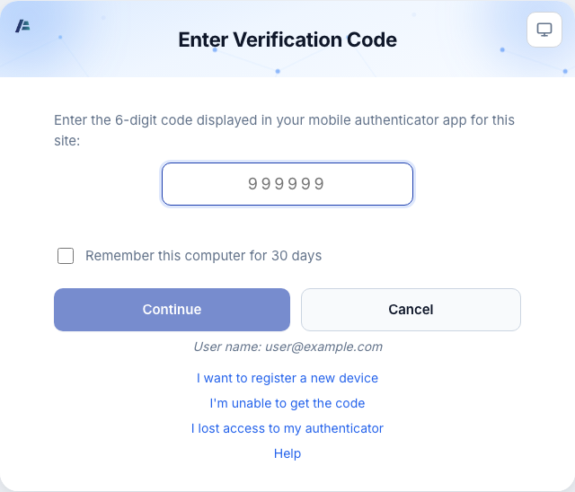
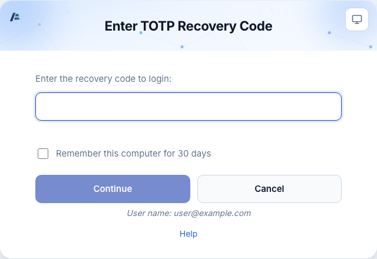
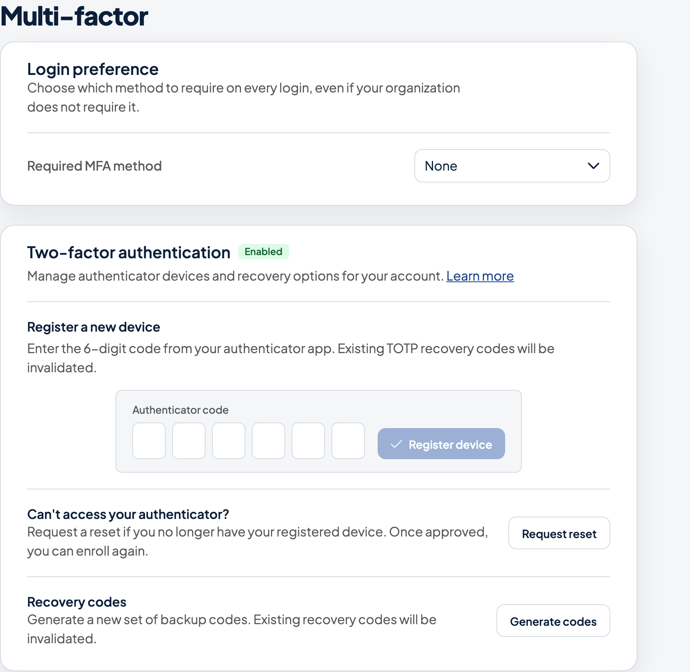
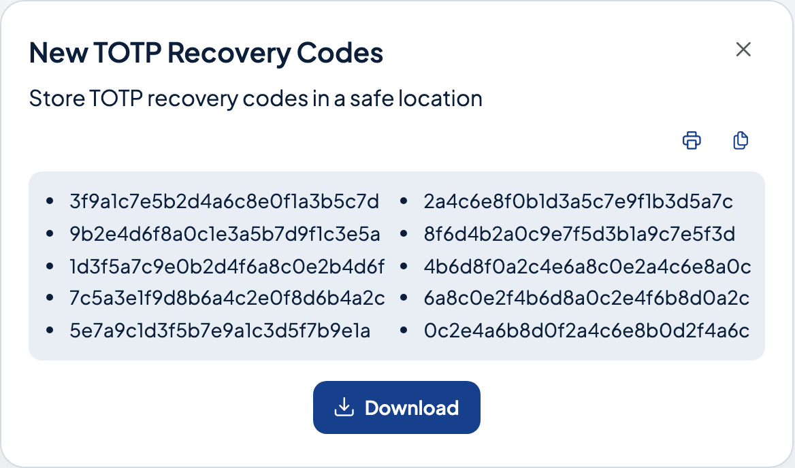
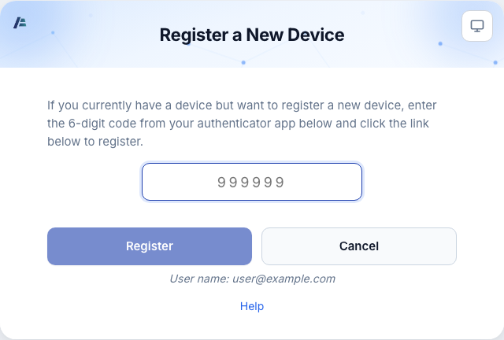
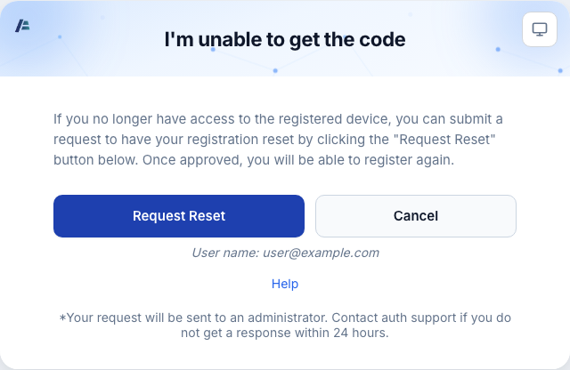

<!-- Generated from idbroker: packages/auth/docs/two-factor-authentication.md. Edit it there, not in Authifi/docs. -->

# Two-Factor Authentication (2FA)

Some applications require two-factor authentication (2FA) for increased security. After you sign in with your usual identity provider, Authifi asks for a one-time code from an authenticator app on your mobile device. This guide covers setting up the app, signing in with it, and what to do if you lose access to it.

## Set up 2FA

You set up 2FA the first time an application that requires it asks you to. The page is titled **Mobile Authenticator Setup**.

### 1. Install an authenticator app

If you do not already have one, install an authenticator app on your mobile device. Many free apps work. These have been used successfully:

- [Google Authenticator](https://support.google.com/accounts/answer/1066447)
- [Microsoft Authenticator](https://www.microsoft.com/en-us/account/authenticator)
- [FreeOTP](https://freeotp.github.io/)
- [Duo Mobile](https://duo.com/product/multi-factor-authentication-mfa/duo-mobile-app)

### 2. Scan the barcode

Open the app and scan the barcode (also called a [QR code](https://en.wikipedia.org/wiki/QR_code)) shown on the setup page.

How to start a scan depends on the app:

- **Google Authenticator**: tap the "+" icon, then "Scan a QR code".
- **Microsoft Authenticator**: tap the three-dot menu, then "+ Add account".
- **FreeOTP**: tap the QR code icon. If the app asks for an issuer, enter a name you will recognize, such as the name of the application you are signing in to.
- **Duo Mobile**: tap the "+" icon.

If you cannot scan the barcode, you can type the code printed on the setup page into the app instead.

When the scan succeeds, the app lists a new account.

### 3. Enter the 6-digit code

Select the new account in the app, type the 6-digit code it shows into the box on the setup page, and click **Submit**.

### Troubleshooting setup

- Make sure the time on your mobile device is accurate to within a few seconds. You can check it against [time.gov](https://time.gov). If it is off, go to your phone's settings and turn automatic clock sync off and back on.
- Codes change every 30 seconds. Enter the code soon after the timer restarts. Depending on clock differences, a code can still work briefly after it has expired in the app.
- If the first code is rejected, start over by scanning the barcode again.
- Try a different browser, or a private or incognito window.

**Tip:** After you finish, you can rename the account in the app so you can tell which site it belongs to.

## Save your recovery codes

When setup succeeds, Authifi shows a set of 10 one-time recovery codes. Use one if you lose access to your authenticator app. Store the codes somewhere secure: you cannot view them again after you leave the page. Use the print and copy icons or the **Download** button on the page to save them.

Click **Continue** when you have saved them.

If you think someone else has seen your recovery codes, [generate a new set](#generate-new-recovery-codes). Generating a new set invalidates the old one. An administrator can also reset your 2FA.

## Sign in with 2FA

After you register, applications that require 2FA ask for a code each time you sign in:

1. Open the authenticator app and select the account you registered for this site.
2. Enter the 6-digit code on the **Enter Verification Code** page.
3. Click **Continue**.

**Tip:** On a trusted device that only you use, select **Remember this computer** to skip the code on later sign-ins. The checkbox appears only when your organization allows it, and the number of days is set by your organization (30 by default).

## Sign in with a recovery code

If you cannot use your authenticator app, click **I lost access to my authenticator** on the verification page. This link appears only if you still have unused recovery codes.

Enter one of your unused recovery codes and click **Continue**. A code works once, so it is invalidated after you use it. Entering too many invalid codes suspends your account (see [Suspensions and lockouts](#suspensions-and-lockouts)).

## In the User Portal

Sign in and open **Multi-factor**. From there you can register a new device, request a reset, and generate new recovery codes.

## Generate new recovery codes

To replace your recovery codes, open the **Recovery codes** section on that page, click **Generate codes**, and confirm. The new codes are shown once, so store them somewhere secure. Existing recovery codes stop working.

If you do not see **Generate codes**, your account may be suspended or locked out. Contact your administrator.

## Register a new device

### You still have your old device

On the verification page, click **I want to register a new device**. Enter the current 6-digit code from your existing authenticator app, click **Register**, then follow the prompts to set up the new device.

You can also do this from the User Portal's multi-factor page. Registering a new device there invalidates your existing recovery codes, so save the new set.

### You no longer have your old device

On the verification page, click **I'm unable to get the code**, then click **Request Reset**. The request is sent to an administrator, and it must be approved before you can register again. Follow the instructions in any email you receive about the request. If you do not get a response within 24 hours, contact support.

If you still have unused recovery codes, you can [sign in with one](#sign-in-with-a-recovery-code) instead.

## Suspensions and lockouts

After too many invalid verification or recovery codes, your account is suspended for a short time and you cannot sign in. The sign-in page tells you how many minutes to wait. You can sign in again when the suspension ends.

If invalid attempts continue, your account is locked and you cannot sign in with 2FA or recovery codes. To regain access, contact your administrator. The number of attempts and the length of a suspension are set by your administrator.

## If your organization already uses 2FA

Many organizations require 2FA at their own sign-in. Depending on how your organization's sign-in is configured, you may still be asked to verify twice. If you sign in from a trusted device, **Remember this computer** reduces how often that happens. You can usually use the same authenticator app, adding a separate account for this site, by following the steps above. To avoid the second prompt, ask your administrator whether it can be adjusted.

## Get help

If you need more help, contact your administrator or the support contact for the application you are signing in to.
